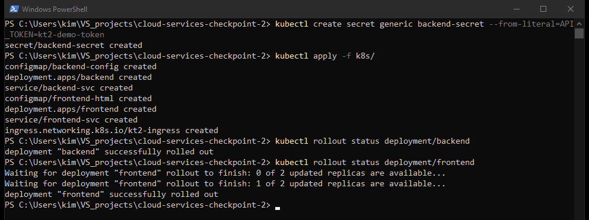
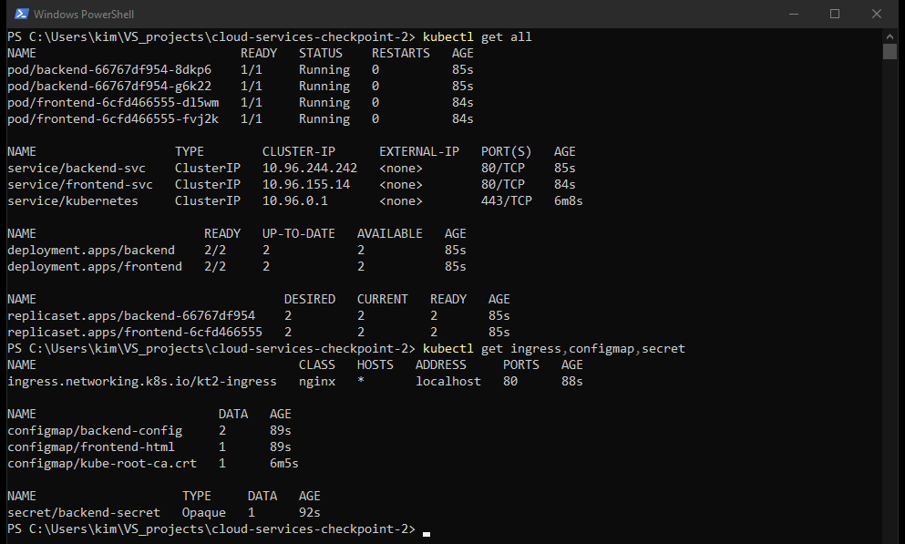
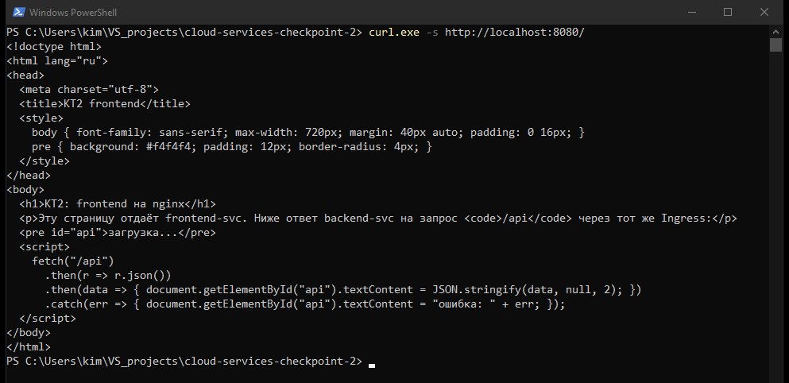
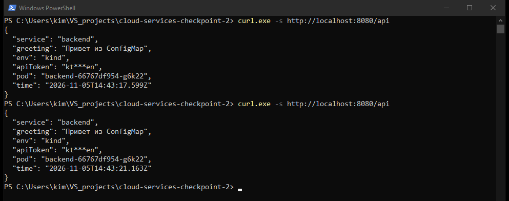
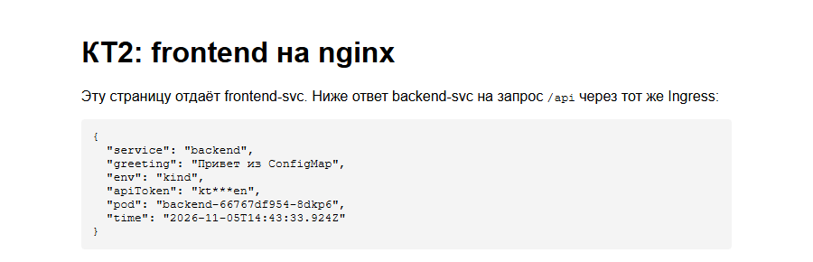

# КТ2. Многокомпонентное приложение в kind

Выполнил: Ким Тэ Ян

## Задание

Финальное задание объединяет все три блока. Развернуть в kind-кластере многокомпонентное приложение:

- Frontend (можно взять nginx-конфигурацию из модуля Terraform как отправную точку): Deployment + Service;
- Backend: свой собранный образ (Python/Node/что угодно), Deployment + Service;
- ConfigMap: конфигурация backend (например, адрес, к которому он стучится, или текстовое сообщение);
- Secret: хотя бы одно «чувствительное» значение (даже условное, для тренировки механики `kubectl create secret`);
- Ingress: единая точка входа снаружи, с маршрутизацией `/` → frontend, `/api` → backend.

Что сдается:

- все YAML-манифесты (в репозитории);
- скриншот/вывод `kubectl get all` в работающем состоянии;
- скриншот/вывод успешного запроса через Ingress к обоим сервисам;
- скриншоты оформить в ридми вместе с заданием;
- опционально: упаковать все в Helm-чарт вместо голых манифестов.

## Окружение

- Windows 10 Pro 22H2, Docker Desktop (Docker Engine 29.5.3)
- kind 0.33.0, Kubernetes v1.37.0 на ноде
- kubectl 1.34.1
- ingress-nginx controller v1.15.1

## Файлы

| Путь | Содержимое |
|---|---|
| `kind-config.yaml` | конфигурация кластера: метка `ingress-ready`, проброс портов 80/443 ноды на 8080/8443 хоста |
| `backend/` | код backend (`server.js`), `package.json`, `Dockerfile` |
| `k8s/backend-config.yaml` | ConfigMap `backend-config` |
| `k8s/backend.yaml` | Deployment и Service backend |
| `k8s/frontend.yaml` | ConfigMap со страницей, Deployment и Service frontend |
| `k8s/ingress.yaml` | Ingress с маршрутами `/` и `/api` |
| `screenshots/` | скриншоты выполнения |

## Как устроено приложение

Frontend работает на образе `nginx:1.28-alpine` в двух репликах. Страницу `index.html` он берёт из ConfigMap `frontend-html`, который смонтирован в `/usr/share/nginx/html`. На странице есть небольшой скрипт: он запрашивает `/api` через тот же Ingress и показывает ответ backend.

Backend собран из своего образа `kt2-backend:1.0`: Node.js 24 на alpine, без внешних зависимостей, процесс запускается от пользователя `node`. Он тоже работает в двух репликах. На `GET /api` backend возвращает JSON с приветствием, окружением, именем пода и временем, на `GET /api/health` отвечает для readinessProbe. Service `backend-svc` принимает порт 80 и передаёт на 3000.

ConfigMap `backend-config` хранит `GREETING` и `APP_ENV`, в контейнер они попадают через `envFrom`. Secret `backend-secret` с ключом `API_TOKEN` подключён через `secretKeyRef`. Backend не возвращает токен целиком, только первые и последние два символа (`kt***en`), чтобы по ответу было видно, что Secret дошёл до пода.

Манифеста Secret в репозитории нет. Значение задаётся командой `kubectl create secret` при развёртывании, так токен не попадает в git. Здесь он учебный, но порядок тот же, что и для настоящего.

Ingress `kt2-ingress` с классом `nginx` направляет `/api` на `backend-svc`, а всё остальное на `frontend-svc`. Ingress-nginx выбирает самый длинный подходящий префикс, поэтому запрос `/api` уходит в backend, хотя правило `/` тоже под него подходит.

В kind-кластере контроллер ingress-nginx слушает порты 80 и 443 ноды. На моей машине порт 80 занят другим проектом, поэтому в `kind-config.yaml` они проброшены на 8080 и 8443, и снаружи приложение открывается на http://localhost:8080.

## Запуск

Команды для PowerShell, из корня репозитория:

```
kind create cluster --name kt2 --config kind-config.yaml

kubectl apply -f https://raw.githubusercontent.com/kubernetes/ingress-nginx/controller-v1.15.1/deploy/static/provider/kind/deploy.yaml
kubectl wait --namespace ingress-nginx --for=condition=ready pod --selector=app.kubernetes.io/component=controller --timeout=180s

docker build -t kt2-backend:1.0 backend
kind load docker-image kt2-backend:1.0 --name kt2

kubectl create secret generic backend-secret --from-literal=API_TOKEN=kt2-demo-token
kubectl apply -f k8s/

curl.exe -s http://localhost:8080/
curl.exe -s http://localhost:8080/api
```

Версия ingress-nginx зафиксирована тегом `controller-v1.15.1`, а не веткой `main`, как в методичке: манифест из `main` со временем меняется, и через месяц та же команда может поставить другую версию.

В PowerShell 5.1 `curl` это псевдоним `Invoke-WebRequest`, поэтому вызывается `curl.exe`. Чтобы кириллица в ответе отображалась нормально, перед запросами выполнена `chcp 65001`.

Удаление стенда:

```
kind delete cluster --name kt2
```

## Ход работы

1. Создан Secret, применены все манифесты из `k8s/`, оба Deployment раскатились.

   

2. `kubectl get all` в рабочем состоянии: по две реплики backend и frontend в статусе Running, сервисы и ReplicaSet. Ingress, ConfigMap и Secret в `get all` не входят, поэтому выведены отдельной командой.

   

3. Запрос через Ingress на `/` снаружи кластера возвращает страницу frontend.

   

4. Запрос через Ingress на `/api` возвращает JSON от backend. В ответе приветствие из ConfigMap, `env` из ConfigMap и замаскированный токен из Secret.

   

5. Та же страница в браузере. Скрипт на странице получил ответ `/api`, на этот раз от второй реплики backend (`8dkp6`).

   

Helm-чарт (опциональный пункт) не делал, приложение развёрнуто голыми манифестами.
